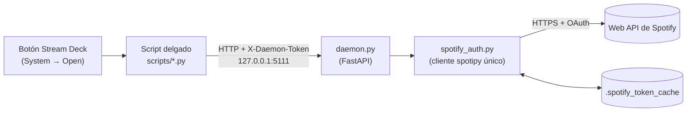
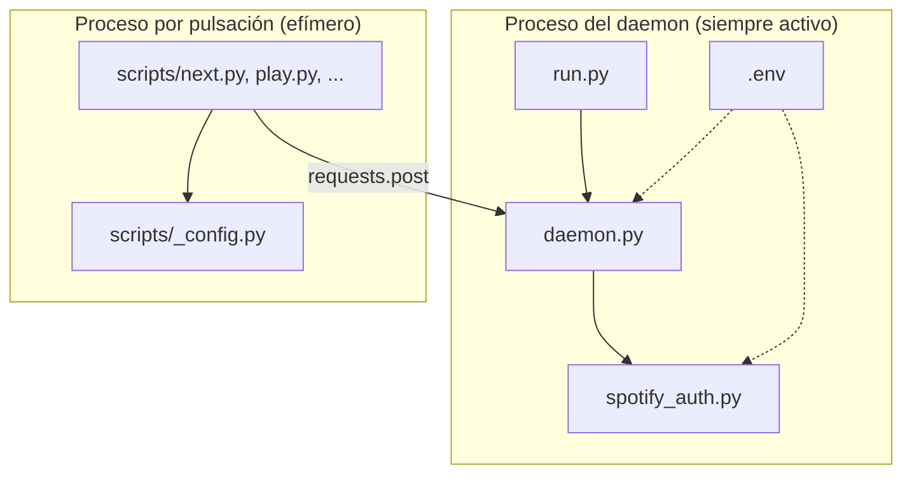
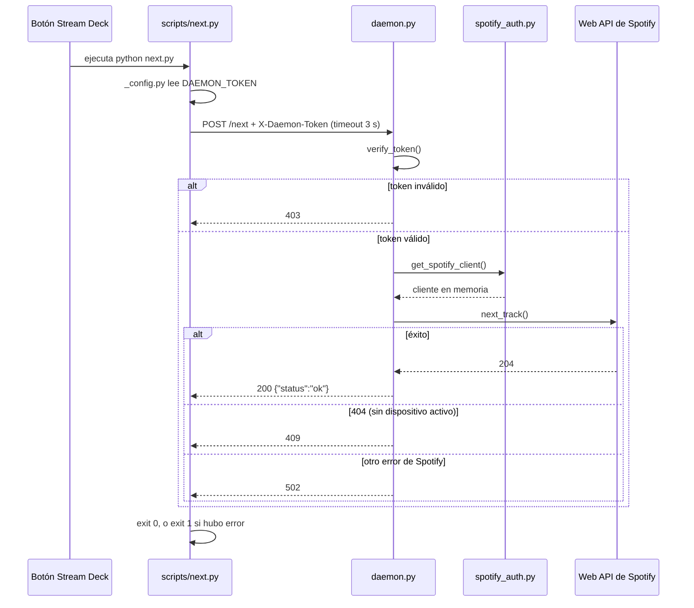
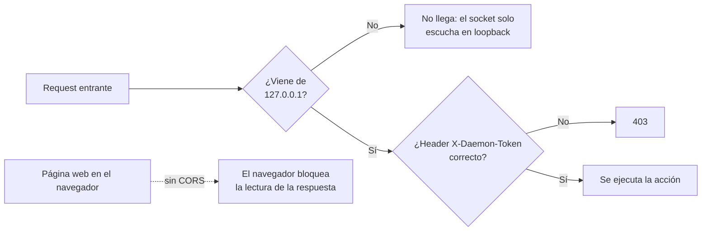
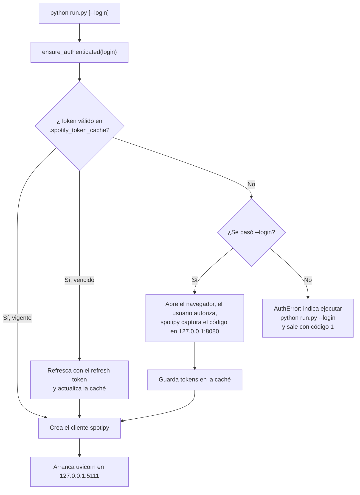
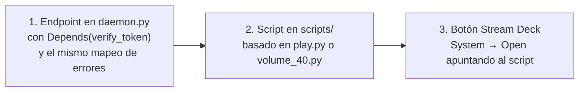

# Arquitectura

Este documento describe cómo encajan las piezas del proyecto. Para instalar y configurar, ver el [README](README.md).

## Visión general

Un daemon local mantiene la sesión de Spotify abierta. Cada botón del Stream Deck ejecuta un script muy pequeño que solo hace una llamada HTTP al daemon.

¿Por qué dos procesos? Arrancar Python, importar `spotipy` y autenticarse en cada pulsación sería lento. El daemon paga ese costo una vez, y los scripts de los botones arrancan casi al instante porque solo importan `requests`.

## Componentes

| Archivo | Rol |
|---|---|
| `run.py` | Punto de entrada. Autentica con Spotify (`--login` para la primera vez) y lanza uvicorn con `host="127.0.0.1"` fijo. |
| `daemon.py` | App FastAPI. Define los endpoints y valida el token. |
| `spotify_auth.py` | Único lugar que crea el `SpotifyOAuth`. `ensure_authenticated()` deja listo el cliente spotipy al arrancar y `get_spotify_client()` lo devuelve. |
| `scripts/_config.py` | URL del daemon, lectura de `DAEMON_TOKEN` y cabeceras comunes. |
| `scripts/play.py`, `pause.py`, `next.py`, `previous.py` | Un POST sin parámetros cada uno. |
| `scripts/volume_40.py` | POST con `?level=N`. Plantilla para botones de volumen. |

## Ciclo de una pulsación

El script sale con código 1 ante cualquier error HTTP o de conexión y escribe el motivo en stderr. Stream Deck no muestra esa salida, así que para depurar conviene ejecutar el script a mano desde una terminal.

## Seguridad

Las tres defensas se complementan y las tres deben mantenerse:

- **Bind a loopback**: `run.py` fija `127.0.0.1`. Con `0.0.0.0` cualquier dispositivo de la red local podría llegar al daemon.
- **Token compartido**: evita que una pestaña del navegador mande requests simples al daemon sin que lo notes.
- **Sin CORS**: no se registra `CORSMiddleware`, por lo que las páginas web no pueden leer las respuestas desde JavaScript.
- `/health` es el único endpoint sin token.

## Autenticación con Spotify

Se usa el flujo Authorization Code de `SpotifyOAuth`. La autenticación se resuelve **una sola vez al arrancar**, en `run.py`, antes de levantar uvicorn. Los requests solo reutilizan el cliente ya creado.

Puntos a tener en cuenta:

- Solo `python run.py --login` puede abrir el navegador. El arranque normal, por ejemplo desde el Programador de tareas, falla con un error claro si falta el token y no se queda esperando.
- `SPOTIFY_CACHE_PATH` se resuelve contra la carpeta del proyecto si es relativo (o se usa tal cual si es absoluto), por lo que no depende del directorio desde el que se lance el daemon.
- El `SPOTIFY_REDIRECT_URI` debe coincidir exactamente con el registrado en el dashboard de Spotify.
- Scopes solicitados: `user-read-playback-state`, `user-modify-playback-state`, `user-read-currently-playing`.

## Endpoints

| Endpoint | Método | Llamada spotipy | Notas |
|---|---|---|---|
| `/health` | GET | — | Sin token. |
| `/play` | POST | `start_playback()` | |
| `/pause` | POST | `pause_playback()` | |
| `/next` | POST | `next_track()` | |
| `/previous` | POST | `previous_track()` | |
| `/volume?level=N` | POST | `volume(N)` | `N` entre 0 y 100, si no responde 400. |
| `/now-playing` | GET | `current_playback()` | Devuelve pista, artistas y progreso. No traduce errores de Spotify. |

Mapeo de errores en los endpoints de acción: `SpotifyException` con 404 pasa a HTTP 409 (sin dispositivo activo) y cualquier otra pasa a HTTP 502.

## Cómo añadir una acción nueva

